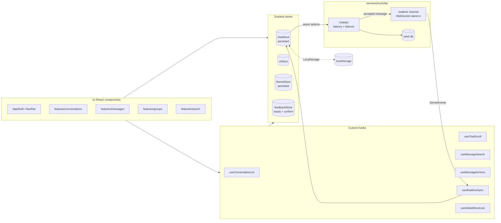

# Quantum Chat

An enterprise chat client inspired by Slack and WhatsApp Web, visually modeled on the Quantum Heaps design language (dark-first, black and charcoal surfaces, electric-blue accents, Funnel Display + DM Sans). Built as the **Senior Frontend Developer take-home assignment**.

There's no backend. A mock API layer simulates network latency, failures, and a WebSocket-style realtime channel, so the app runs with zero configuration.

## Quick start

Requires **Node 20+** (developed on Node 24).

```bash
npm install
npm run dev        # http://localhost:5173
npm test           # Vitest unit + component tests
npm run build      # type-check + production build
```

Tip: **Profile menu → Reset demo data** restores the seed data (state is persisted in LocalStorage).

## Tech stack

| Concern | Choice |
| --- | --- |
| Framework | React 19 + Vite (SPA; no SSR needed for a client-only chat) |
| Language | TypeScript (strict) |
| Styling | Tailwind CSS v4 with CSS-variable design tokens |
| State | Zustand (+ `persist` middleware) |
| Forms | React Hook Form (composer, add-members dialog) |
| Icons | Lucide React |
| Tests | Vitest + Testing Library (jsdom) |

No other runtime dependencies. Emoji picker, menus, modals, and toasts are small in-house components.

## Architecture



### Folder structure

```
src/
  components/
    ui/          Avatar, Button/IconButton, Menu, Modal, EmptyState (design-system primitives)
    layout/      AppShell (responsive 3-panel), NavRail, Logo
    shared/      Toaster, ConfirmDialog, ShortcutsDialog, ErrorBoundary
  features/
    conversations/  list, item, useConversationList, pure summary/filter utils
    messages/       ChatWindow, header, list, bubble, toolbar, composer, emoji picker,
                    useChatScroll, useMessageSearch, useMessageActions, groupMessages util
    groups/         InfoPanel, MemberList, AddMembersDialog, SharedContent
    search/         SearchInput, Highlight, useDebouncedValue
    theme/          ThemeToggle, useApplyTheme
  hooks/         app-wide hooks: useRealtimeSync, useGlobalShortcuts, useMediaQuery
  store/         chatStore, uiStore, themeStore, feedbackStore, selectors
  services/mockApi/  chatApi, realtime, request (latency/failure), db (seed materialisation)
  data/          seed users + conversation scripts
  types/         domain models (User, Conversation, Message, Reaction, Attachment, MessageStatus)
  utils/         date/format helpers, safe storage, ids
```

## State management

**Why Zustand:** the state is a few normalized maps with frequent, fine-grained updates (status ticks, typing, reactions). Zustand gives selector-based subscriptions without providers or boilerplate, and stores are callable outside React (`useChatStore.getState()`). The realtime bridge, the global shortcuts, and the promise-based `confirm()` all rely on that.

| Store | Holds | Persisted |
| --- | --- | --- |
| `chatStore` | users, conversations, messages per conversation, pagination cursors, active conversation, typing | ✅ (except typing/loading) |
| `uiStore` | filter, panel visibility, composer reply/edit context, message-search toggle | ❌ (presentational) |
| `themeStore` | dark / light | ✅ (applied before first paint to avoid a flash) |
| `feedbackStore` | toasts, the single confirm-dialog request | ❌ |

Key decisions:

- **Normalized data.** `conversations: Record<id, Conversation>` and `messages: Record<conversationId, Message[]>`. Updating one message replaces only that conversation's array and that message object, so memoized `MessageBubble`s in other rows and conversations skip re-rendering.
- **Derived, not duplicated.** Last-message preview, ordering, titles, and unread totals are computed by pure selectors (`store/selectors.ts`, `conversationSummary.ts`) instead of being stored, so they can't drift out of sync.
- **Optimistic updates.** Sends insert a `sending` bubble immediately, then reconcile with the server's answer. A failure marks the message `failed` with a retry. Edit, delete, and member changes apply instantly and roll back on error. Status transitions are monotonic: a late HTTP response can never downgrade `read` to `sent`.
- **Realtime as events.** `services/mockApi/realtime.ts` emits typed `ServerEvent`s (`message:new`, `message:status`, `typing`, `presence`). `useRealtimeSync` is the only place that maps events into store actions. Swapping in a real WebSocket would only touch that file. All timers live in the channel and are cleared on disconnect.
- **Cursor pagination.** The mock server holds the full history. The client loads the latest 30 messages and fetches older pages by `before` timestamp when you scroll to the top, with the scroll position preserved.
- **Persistence.** `persist` + `partialize` stores the useful state (not typing or loading flags). Messages caught mid-send when the tab closed rehydrate as `failed`. Seed timestamps are pinned to a stored anchor, so persisted messages and lazily fetched older pages stay on one timeline.

## Features

- **Sidebar:** nav rail (All / Unread / Groups with unread badge), conversation search (debounced, highlighted), avatars with presence, last message + timestamp, unread badges, muted icon, typing preview, active highlight; loading skeleton, empty and error states
- **Chat:** date separators, same-sender grouping, avatar and name in groups, reply quotes (click to jump), reactions, attachments, `sending → sent → delivered → read` ticks, failed + retry, "edited" label, typing indicator (header + floating pill), smart auto-scroll with a "N new messages" pill, infinite scroll for older history
- **Message actions:** react, reply, copy, edit (own), delete (own, with confirmation); hover toolbar on desktop, tap-to-reveal on touch
- **Composer:** React Hook Form, auto-growing textarea, emoji picker, attachments (images preview inline; images ≤1.5 MB persist as data URLs), reply/edit context bar
- **Header:** presence / last seen / member count, message search (debounced, highlighted, next/prev navigation), info toggle, more menu (mute, mark unread, clear messages)
- **Info panel:** contact details (email, local time) or group description + members with presence, add members (dialog), remove member (confirmation), shared media and files
- **UX:** dark (default) and light themes, toasts, confirm dialogs, error boundary, accessible labels on every icon control, focus-visible rings, reduced-motion support

### Responsive behaviour

| Width | Layout |
| --- | --- |
| < 768px | Conversation list is the home screen. Opening a chat goes full-screen with a back button. Nav becomes a bottom tab bar. Info panel is a full-screen sheet. |
| 768–1279px | Rail + collapsible list + chat. Info panel is a slide-over drawer. |
| ≥ 1280px | Rail + list + chat + inline info panel. |

### Keyboard shortcuts

| Keys | Action |
| --- | --- |
| `Ctrl/⌘ + K` | Search conversations |
| `Alt + ↑ / ↓` | Previous / next conversation |
| `Ctrl/⌘ + Shift + F` | Search messages in the open conversation |
| `Enter` / `Shift + Enter` | Send / new line |
| `↑` in empty composer | Edit your last message |
| `Esc` | Cancel reply or edit, close search or panel |

## Testing

`npm test` runs 32 tests across 5 files:

- `store/chatStore.test.ts`: send (optimistic → sent), failure + retry, replies, edit (own only), soft delete, add/remove reactions, unread increment / reset / duplicate-ignore / mark-unread, monotonic status, typing, pagination, add/remove members
- `conversationSummary.test.ts`: ordering, previews, Unread / Groups filters, search
- `groupMessages.test.ts`: day sections and sender runs
- `ConversationList.test.tsx`: rendering, debounced search with highlights, Unread filter, switching conversation clears its badge
- `Composer.test.tsx`: Enter sends, Shift+Enter / empty doesn't, ↑ edits the last message

Tests run the real stores against the mock API with latency set to 0.

## Assumptions, trade-offs, and known gaps

- **Single signed-in user** ("Alex Morgan"). You can't create new conversations or groups; the spec doesn't ask for it.
- **Filters = nav items.** "All / Unread / Groups" appear once, in the nav rail (bottom bar on mobile), rather than as a duplicate control above the list.
- **Mute** greys out the conversation's badge and excludes it from the total unread count and the tab title. There are no OS or sound notifications to suppress.
- **Delete** is a soft "deleted for everyone" tombstone. There's no "delete for me".
- **Attachments are local only.** Non-image files, and images over 1.5 MB, keep only their metadata (no download). Shared-media thumbnails aren't clickable (no lightbox).
- **Message search** runs client-side. While a query is active it pulls the remaining history pages from the mock server; a real backend would search server-side.
- **Avatars** come from `i.pravatar.cc` and seed images from `picsum.photos`. Both fall back gracefully offline (initials or a blank tile).
- **Optional challenges not implemented:** a virtualized list for 10k+ messages (pagination keeps the DOM small, but a fully loaded 10k history isn't virtualized), the offline message queue, and real WebSockets (a WebSocket-shaped mock channel is used instead).
- **Touch:** message actions open with a tap on the bubble rather than a long-press.
- The mock send endpoint fails about 5% of the time on purpose, so the retry path is visible during review.
